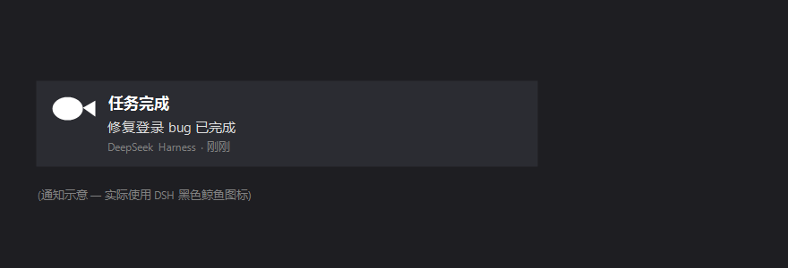

# dsh-notify

[English](#english) · [中文](#中文)

System notifications for **DeepSeek Harness (DSH)**: when a session's AI turn finishes, DSH raises a system notification carrying its black-whale mark and tells you **which task** completed.



---

## English

### How it works (and why it is built this way)

The **host** subscribes to the session log's own `session/event` stream and reacts to `turn/end`; the **browser** receives those completions over Server-Sent Events and raises the notification.

This split is deliberate. Earlier versions tried to detect completion in the browser by reading client-side projections, and both attempts failed silently:

| Attempt | Why it never fired |
|---|---|
| `sessions.list.byId[*].running` | DSH 0.2.x keeps `running` on the session object and no longer refreshes the list row live, so no `true → false` edge ever appeared. |
| `sessions.binding(id).session` | `binding()` returns `this.scopes.get(id)?.binding` — it only answers for an **already-retained** scope, so a root-level plugin got `undefined` for every session. |

Both are private internals. `session/event` is the documented seam — the `dsh-session` package documents *"Persistence is a plugin concern (subscribe to `session/event`, drain on `session/flush`)"* — and `turn/end` is a stable type in the session log's own event vocabulary. The host also has the durable session header, so titles come from the source of truth rather than from a UI projection.

### Behaviour

- Fires for **every** finished turn, in any session.
- Title `任务完成` (`任务出错` when the turn failed); body names the session.
- Icon: the **DeepSeek whale**, served by the host at `/dsh-notify/whale.svg` and rasterized to a PNG in the browser (Windows toasts prefer a bitmap).
- **Click** the notice to ask the shell to focus that session.
- One `EventSource` handles reconnection on its own.

### Install

```sh
dsh plugin --profile web add github:SailingBoat-ovo/dsh-notify
dsh plugin --profile desktop add github:SailingBoat-ovo/dsh-notify
```

**Restart DSH afterwards** — the node half is loaded at boot, so a page refresh alone is not enough.

### Diagnosing

**Settings → General** shows the permission state, a **"Send a test notification"** button, and the live link state:

```
Link: live · 3 completion event(s) received
```

- Test button works but the counter stays 0 → the host half is not loaded (restart DSH).
- Counter grows but no toast → the OS/browser is suppressing notifications.

### Endpoints

| Path | Purpose |
|---|---|
| `GET /dsh-notify/stream` | `text/event-stream` of completion frames |
| `GET /dsh-notify/completions` | recent completions + current sequence watermark |
| `GET /dsh-notify/whale.svg` | the whale mark |

### Tests

```sh
npm install
npm test
```

`tests/host-test.mjs` (29 assertions) covers the event mapping (only `turn/end` counts; title/cwd/id fallbacks; failure text), the feed (monotonic seq, history cap, detach), and every route including the SSE handshake, a pushed frame, and detach on close. `tests/client-test.mjs` (20 assertions) covers the two-slot registration, the stream wiring, notification content, click-to-open, denied permission, and the settings row.

### License

GPL-3.0-or-later — see [LICENSE](LICENSE) for the full text. Third-party marks: [NOTICE.md](NOTICE.md).

---

## 中文

### 工作原理（以及为什么这样设计）

**宿主**订阅会话日志自身的 `session/event`，对 `turn/end` 作出反应；**浏览器**通过 SSE 收到完成事件后弹出通知。

这个分工是刻意的。此前两版都试图在浏览器里读客户端投影来判断"是否跑完"，两次都静默失效：

| 尝试 | 为什么从不触发 |
|---|---|
| `sessions.list.byId[*].running` | 0.2.x 把 `running` 放在会话对象上，列表行不再实时刷新，因此永远等不到 `true → false` 边沿。 |
| `sessions.binding(id).session` | `binding()` 返回的是 `this.scopes.get(id)?.binding` —— 它只对**已被 retain** 的 scope 有答案，根级插件对每个会话都拿到 `undefined`。 |

这些都是私有内部实现。而 `session/event` 是**文档化的**扩展点（`dsh-session` 包里写明"订阅 `session/event`"是持久化插件的做法），`turn/end` 是会话日志事件词汇表里的稳定类型。宿主还能读到会话的 header，所以标题取自事实来源，而不是 UI 投影。

### 行为

- **任何会话**的每一轮结束都会通知；
- 标题 `任务完成`（该轮失败则 `任务出错`），正文带会话标题；
- 图标是 **DeepSeek 鲸鱼**：由宿主在 `/dsh-notify/whale.svg` 提供，浏览器栅格化成 PNG（Windows 通知偏好位图）；
- **点击通知**让外壳聚焦该会话；
- `EventSource` 自带重连。

### 安装

```sh
dsh plugin --profile web add github:SailingBoat-ovo/dsh-notify
dsh plugin --profile desktop add github:SailingBoat-ovo/dsh-notify
```

**装完必须重启 DSH** —— 宿主半边在启动时加载，只刷新页面不够。

### 怎么排查

**设置 → 通用** 里显示权限状态、**「发一条测试通知」** 按钮，以及实时连接状态：

```
连接：已连接 · 已收到 3 条完成事件
```

- 测试按钮能弹、但计数一直是 0 → 宿主插件没加载（重启 DSH）；
- 计数在涨、但没弹窗 → 系统/浏览器在拦截通知。

### 接口

| 路径 | 用途 |
|---|---|
| `GET /dsh-notify/stream` | 完成事件的 `text/event-stream` |
| `GET /dsh-notify/completions` | 最近的完成记录 + 当前序号 |
| `GET /dsh-notify/whale.svg` | 鲸鱼图标 |

### 测试

```sh
npm install
npm test
```

`tests/host-test.mjs`（29 项）覆盖事件映射（只有 `turn/end` 算数；标题/cwd/id 兜底；失败信息）、feed（序号单调、历史上限、解绑），以及全部路由（含 SSE 握手、推送一帧、断开解绑）。
`tests/client-test.mjs`（20 项）覆盖两个 slot 注册、流接线、通知内容、点击跳转、权限拒绝、设置行渲染。

### 许可

GPL-3.0-or-later，完整文本见 [LICENSE](LICENSE)；第三方说明见 [NOTICE.md](NOTICE.md)。